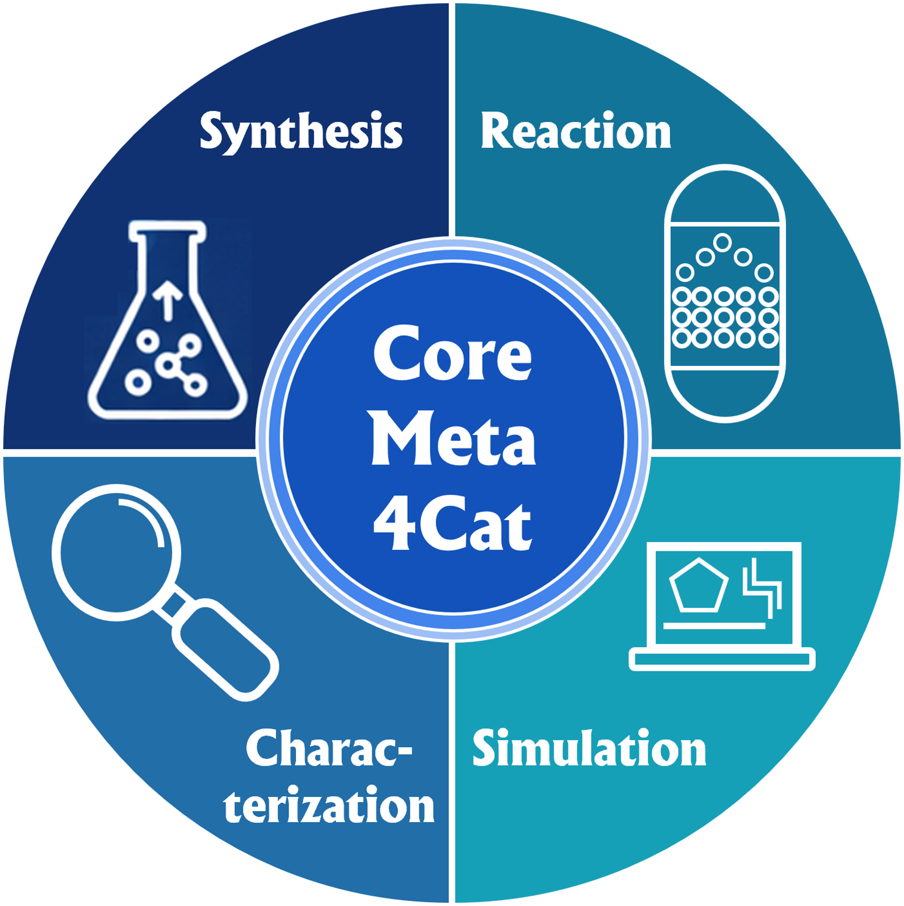

# Design Patterns

This page explains the key structural decisions behind CoreMeta4Cat — how the four data classes are modelled, how they connect to a dataset, and what design patterns make the schema extensible and machine-actionable.

<div style="text-align: center;" markdown>
{ style="width: 40%;" }
</div>

---

## Reading guide

This page is written in three tiers. Most users only need the first two.

| Tier | Who it's for | Sections |
|---|---|---|
| **Overview** | Everyone — data providers, repository managers | [The entry point](#the-entry-point-catalysisdataset), [The four data classes](#the-four-data-classes) |
| **Pattern explanations** | Users who want to understand how to navigate or extend the schema | [Classification pattern](#pattern-1-classification-via-rdf_type), [Activity pattern](#pattern-2-activities-and-plans), [Mixin pattern](#pattern-3-mixin-classes) |
| **Technical depth** | Schema developers and DCAT-AP-PLUS integrators | [Sections marked with 🔬](#deep-dive-the-evaluatedactivity-distinction) |

---

## The entry point: CatalysisDataset

Every CoreMeta4Cat record starts with a **`CatalysisDataset`**. This is a `dcat:Dataset` — fully compatible with plain DCAT and DCAT-AP — extended with link slots that connect it to the four CoreMeta4Cat data classes.

```yaml
id: ex:dataset-001                      # the CatalysisDataset, a dcat:Dataset

# Layer 1: global classification (one or more research fields)
rdf_type:
  - id: voc4cat:0007001
    title: "heterogeneous catalysis"

# Layer 2: links to the four data classes
was_generated_by:                       # ids of the activities that produced the data
  - ex:synthesis-001
  - ex:characterization-001
was_generated_by_synthesis:             # each activity in full, under its kind
  - id: ex:synthesis-001
was_generated_by_characterization:
  - id: ex:characterization-001

is_about_activity:
  - id: ex:reaction-001                 # a CatalyticReaction

is_about_entity:
  - id: ex:catalyst-001                 # a CatalystSample
```

The key points here are:

- `rdf_type` carries a **controlled vocabulary term** from [Voc4Cat](https://nfdi4cat.github.io/voc4cat/) to classify which field of catalysis the dataset belongs to.
- `was_generated_by` links to **activities that produced the data** (Synthesis, Characterization, Simulation) by their ids. Each activity is described under the field for its kind (`was_generated_by_synthesis`, `was_generated_by_characterization`, `was_generated_by_simulation`), which also gives it its class in RDF.
- `is_about_activity` links to the **Reaction being studied** — which is the catalytic process itself, not a data-generating step.
- `is_about_entity` links to the **catalyst sample or material** the dataset concerns.

---

## The four data classes

The four CoreMeta4Cat data classes — **Synthesis**, **Characterization**, **Reaction**, and **Simulation** — are the core of the metadata model. Each is a separate class, defined in its own subprofile module, and linked from the `CatalysisDataset` via the slots above.

```
coremeta4cat.yaml  (aggregator + CatalysisDataset)
  ├── coremeta4cat_common.yaml          (shared slots and enumerations)
  ├── coremeta4cat_synthesis_ap.yaml    (Synthesis + 15 preparation methods)
  ├── coremeta4cat_characterization_ap.yaml  (Characterization + 27 techniques)
  ├── coremeta4cat_reaction_ap.yaml     (Reaction + 8 reactor types)
  └── coremeta4cat_simulation_ap.yaml   (Simulation + 4 methods + 17 properties)
```

### Synthesis

**What it is:** The process of preparing a catalyst. Synthesis is a `DataGeneratingActivity` — it produces data *about* the preparation, and it produces a `CatalystSample` as its physical output.

**Key links:**

- `realized_plan` → a `PreparationMethod` subclass (the protocol used)
- `had_input_entity` → `Precursor` instances (the starting materials)
- `had_output_entity` → `CatalystSample` (the resulting catalyst)

Fifteen preparation methods are currently defined, each as a concrete `PreparationMethod` subclass:

- **Wet chemistry:** Impregnation, Co-Precipitation, Deposition-Precipitation, Sol-Gel, Molecular Synthesis
- **Thermal / gas-phase:** Solvothermal, Combustion Synthesis, Flame Spray Pyrolysis, Sublimation, Plasma-Assisted
- **Mechanical / energy-assisted:** Mechanochemical Synthesis, Microwave-Assisted, Sonochemical Synthesis
- **Surface / thin-film:** Atomic Layer Deposition, Exsolution Synthesis

### Characterization

**What it is:** The measurement of a catalyst or catalytic system using an analytical technique. Characterization is also a `DataGeneratingActivity` — it produces measurement data.

**Key links:**

- `evaluated_entity` → the `CatalystSample` or material being measured
- `evaluated_activity` → the `CatalyticReaction` being measured, e.g. in product analysis or operando experiments
- `realized_plan` → a `CharacterizationTechnique` subclass (the measurement protocol)
- `carried_out_by` → the instrument (`Device`) performing the measurement

Twenty-seven techniques are currently defined, organised into groups:

| Group | Techniques |
|---|---|
| Diffraction | Powder XRD, Single Crystal XRD |
| X-ray spectroscopy | XAS/XANES/EXAFS, XPS, EDX |
| Vibrational spectroscopy | FTIR, DRIFTS, Raman |
| Magnetic resonance | NMR |
| Electron microscopy | TEM, SEM |
| Thermal analysis | TGA, TPR, TPO |
| Surface & pore analysis | BET |
| Elemental analysis | ICP-AES, Elemental Analysis (CHNS) |
| Optical & electronic | UV-Vis, Photoluminescence, Photoluminescence Lifetime |
| Electrochemistry | Cyclic Voltammetry, Conductivity Measurement |
| Particle sizing | Dynamic Light Scattering |
| Mass spectrometry | ESI-MS, GC-MS, HPLC-MS |
| Chromatography | Size Exclusion Chromatography |

### Reaction

**What it is:** The catalytic reaction being studied. Unlike Synthesis and Characterization, Reaction is **not** a `DataGeneratingActivity`. It is the process being *observed*, not the process generating the dataset. In the schema it's named `CatalyticReaction`, and it specializes chemdcat-ap's generic `ChemicalReaction` -- see [Pattern 5: Specializing chemdcat-ap](#pattern-5-specializing-chemdcat-ap-inheritance) below for what that means in practice.

**Key links:**

- `used_reactor` (`is_a: carried_out_by`) → a `ChemicalReactor` (the physical reactor)
- `used_reactant` (`is_a: had_input_entity`) → the reactant feeds
- `product_identification_method` → a `CharacterizationTechnique` used for product analysis

Eight reactor design types are defined:
`FixedBedReactor` · `CSTR` · `PlugFlowReactor` · `Autoclave` · `SlurryReactor` · `Microreactor` · `ElectrochemicalReactor` · `FluidizedBedReactor`

!!! info "Operando experiments"
    For in-situ or operando experiments (e.g. XRD measured while a reaction runs), the dataset carries **both** links simultaneously:
    ```yaml
    was_generated_by:
      - ex:xrd-001
    was_generated_by_characterization:
      - id: ex:xrd-001                          # PowderXRD — the process that made the data
    is_about_activity:
      - id: ex:reaction-001                     # the catalytic process being monitored
    ```

### Simulation

**What it is:** A computational study of a catalyst or catalytic mechanism. Simulation is a `DataGeneratingActivity` — it generates data computationally.

**Key links:**

- `realized_plan` → a `SimulationMethod` subclass (DFT, MD, Microkinetics, MonteCarlo)
- `software_package` → the simulation code and its version (e.g. VASP, Quantum ESPRESSO)
- `evaluated_entity` → the catalyst model or structure being simulated
- `calculated_property` → `CalculatedProperty` subclasses (the computed output)

Seventeen calculated property classes capture the type of computed output: `ElectronicStructure`, `BandGap`, `ThermodynamicStability`, `PhononDispersion`, `Surfaces`, `GrainBoundaries`, `ElasticConstants`, `DielectricTensors`, `EquationsOfState`, `AqueousStability`, `Piezoelectricity`, `Ferroelectrics`, and, specific to catalysis, `AdsorptionEnergetics`, `ReactionEnergetics`, `TransitionState`, `ElectrochemicalFreeEnergy`, `CatalyticDescriptors`.

---

## Pattern 1: Classification via rdf\_type

!!! abstract "Pattern summary"
    Flexible, machine-actionable classification of datasets, activities, and entities using ontology terms — without creating a separate class for every possible value.

Rather than defining a fixed class hierarchy for every type of catalysis or every reaction, CoreMeta4Cat uses the `rdf_type` slot to carry a controlled vocabulary term from Voc4Cat, CHMO, or another ontology. This keeps the schema compact while staying fully machine-actionable.

**On CatalysisDataset** — classify the catalysis research field (mandatory; a list, so several fields can be given):

```yaml
rdf_type:
  - id: voc4cat:0007001
    title: "heterogeneous catalysis"
```

**On CatalyticReaction** — classify the reaction type (mandatory):

```yaml
rdf_type:
  id: voc4cat:0000289
  title: "CO oxidation"
```

**On Synthesis and Characterization** — a method that needs its own parameter slots has its own class (`Impregnation`, `PowderXRD`, …). The plan names that class with `plan_designator`, whose value is the class URI, itself an ontology term:

```yaml
# a Synthesis, in was_generated_by_synthesis
realized_plan:
  id: ex:method-001
  plan_designator: voc4cat:0007028    # Impregnation: the concrete method class with all parameter slots
  title: "incipient wetness impregnation"
```

```yaml
# a Characterization, in was_generated_by_characterization
realized_plan:
  id: ex:xrd-method-001
  plan_designator: CHMO:0000158       # PowderXRD: the concrete technique class with all measurement slots
  title: "powder X-ray diffraction"
```

One value does both jobs: it is the machine-readable ontology term (written as `rdf:type` in RDF), and it tells validators and software which concrete class applies, and so which parameter slots are available. Reactors are selected the same way with `reactor_designator`, and calculated properties with `property_designator`. Activities need no designator: each kind has its own field on the dataset (`was_generated_by_synthesis`, `was_generated_by_characterization`, `was_generated_by_simulation`), and the field tells software which class an activity is.

The allowed values for `rdf_type` on `CatalysisDataset` are defined in `CatalysisResearchFieldEnum` -- see the [CatalysisDataset](catalysis-dataset.md) page for the full value table and a worked example combining multiple pillars into one dataset.

---

## Pattern 2: Activities and Plans

!!! abstract "Pattern summary"
    A two-part structure separates *what was done* (the Activity) from *the protocol describing how to do it* (the Plan). This mirrors the PROV-O model and keeps the schema clean.

Each data class that generates data follows this two-part structure:

```
Activity (what was done)        Plan (the protocol)
─────────────────────────       ───────────────────────────
Synthesis              ──→      PreparationMethod
Characterization       ──→      CharacterizationTechnique
Simulation             ──→      SimulationMethod
```

The Activity carries the **instance-level data** (who did it, when, on what sample, with what output). The Plan carries the **method-level data** (parameter settings, instrument configuration, protocol steps).

```yaml
# The activity — what happened (an entry of was_generated_by_synthesis)
id: ex:synthesis-001
nominal_composition:
  - "5wt% Ni/Al2O3"
catalyst_measured_properties:
  - "BET surface area: 160 m2/g"
had_input_entity:
  - id: ex:precursor-001
    title: "Ni(NO3)2·6H2O"
    precursor_quantity:
      - value: 1.24
        has_quantity_type: http://qudt.org/vocab/quantitykind/Mass
        unit: https://qudt.org/vocab/unit/GM
had_output_entity:
  - id: ex:catalyst-001

# The plan — the protocol
realized_plan:
  id: ex:method-001
  plan_designator: voc4cat:0007028      # Impregnation
  impregnation_type:
    - incipient_wetness
  has_drying_temperature:
    - value: 120.0
      has_quantity_type: http://qudt.org/vocab/quantitykind/Temperature
      unit: https://qudt.org/vocab/unit/DEG_C
  has_calcination_temperature_range:
    - min_value: 500.0
      max_value: 500.0
      has_quantity_type: http://qudt.org/vocab/quantitykind/Temperature
      unit: https://qudt.org/vocab/unit/DEG_C
  has_calcination_dwelling_time:
    value: 4.0
    has_quantity_type: http://qudt.org/vocab/quantitykind/Time
    unit: https://qudt.org/vocab/unit/HR
  has_calcination_atmosphere:
    - value: "air"
```

This separation means a single `PreparationMethod` record could in principle be shared across multiple `Synthesis` activities — a direct gain for reproducibility. That sharing depends on the Plan being independently identifiable, which is why `realized_plan.id` is populated above.

`Plan` (external, DCAT-AP-PLUS) only carries `title`/`description` — no `id`. Rather than repeat an `id` slot on each of `PreparationMethod`, `CharacterizationTechnique`, `SimulationMethod`, and `ProductIdentificationMethod` individually, CoreMeta4Cat inserts one shared intermediate class, `CatalysisPlan` (`is_a: Plan`, abstract), that adds `id` once; all four then specialize `CatalysisPlan` instead of `Plan` directly. `realized_plan` itself needed `inlined: true` added explicitly on each of its class-level overrides (on `Synthesis`, `Characterization`, `Simulation`) once its range became identifier-bearing — LinkML's default for a single-valued, class-typed slot switches from "inline the whole object" to "reference by id" the moment the range class gains an identifier slot, unless told otherwise.

!!! note "Recommended fields and validation"
    Only slots marked `required: true` end up in the generated JSON Schema's `required` array. Slots marked `recommended: true` do not, so a record validates as soon as its Mandatory fields are present. To also list the Recommended fields a record leaves empty, run `linkml-validate` with LinkML's recommended-slot check, as shown in [Getting Started, Level 4](getting-started.md#level-4-validating-against-the-full-schema).

---

## Pattern 3: Mixin classes

!!! abstract "Pattern summary"
    Slot groups that are shared across multiple methods are factored into reusable mixin classes, so each slot is defined exactly once and inherited wherever needed.

Many preparation methods share common process steps — drying, calcination, precipitation. Rather than repeating the same slots in every method class, CoreMeta4Cat uses **mixin classes** that bundle related slots:

| Mixin | Slots it provides | Used by |
|---|---|---|
| `DryingMixin` | `drying_device`, `has_drying_temperature`, `has_drying_duration`, `has_drying_atmosphere` | CoPrecipitation, DepositionPrecipitation, Impregnation, MolecularSynthesis, SolGel, SonochemicalSynthesis |
| `CalcinationMixin` | `has_calcination_temperature_range`, `has_calcination_dwelling_time`, `number_of_cycles`, `has_calcination_atmosphere`, `has_calcination_heating_rate`, `has_calcination_gas_flow_rate` | CoPrecipitation, DepositionPrecipitation, ExsolutionSynthesis, Impregnation, SonochemicalSynthesis |
| `PrecipitationMixin` | `precipitating_agent`, `precipitating_concentration`, `has_ph_value`, `has_mixing_speed`, `has_mixing_duration`, `has_mixing_temperature`, `order_of_addition`, `filtration`, `purification`, `has_aging_temperature`, `has_aging_duration` | CoPrecipitation, DepositionPrecipitation |
| `ThermalSynthesisMixin` | `synthesis_temperature`, `synthesis_duration`, `has_vessel_type`, `has_atmosphere` | CombustionSynthesis, MechanochemicalSynthesis, MicrowaveAssisted, PlasmaAssisted, Solvothermal, Sublimation |

The same pattern is used in the Characterization subprofile for analytical techniques:

| Mixin | Slots it provides | Used by |
|---|---|---|
| `XRaySourceMixin` | `xray_source`, `monochromator` | PowderXRD, SingleCrystalXRD, XPS, XRayAbsorptionSpectroscopy |
| `EnergyRangeMixin` | `has_energy_range` | XPS, XRayAbsorptionSpectroscopy |
| `ElectronMicroscopyMixin` | `gun_type`, `acceleration_voltage`, `magnification_setting` | ScanningElectronMicroscopy, TransmissionElectronMicroscopy |
| `TemperatureProgramMixin` | `has_temperature_range`, `has_heating_rate`, `has_heating_procedure` | TPO, TPR, Thermogravimetry |
| `ChromatographyMixin` | `column_type`, `eluent`, `has_flow_rate`, `has_injection_volume`, `external_standard`, `internal_standard` | GCMS, HighPerformanceLiquidChromatographyMassSpectrometry, SizeExclusionChromatography |
| `MassRangeMixin` | `has_mz_range` | ElectroSprayIonizationMassSpectrometry, GCMS |
| `PhotoluminescenceMixin` | `excitation_wavelength`, `emission_wavelength`, `optical_filter`, `has_temperature` | PhotoluminescenceLifetime, PhotoluminescenceSpectroscopy |
| `ElectrochemistryMixin` | `reference_electrode`, `working_electrode`, `counter_electrode`, `electrolyte_composition`, `electrolyte_concentration`, `has_atmosphere`, `has_temperature` | ConductivityMeasurement, CyclicVoltammetry |

In the Simulation subprofile, two mixins bundle settings and descriptors shared by several calculated properties:

| Mixin | Slots it provides | Used by |
|---|---|---|
| `DFTSettingsMixin` | `energy_cutoff`, `convergence_criteria`, `k_point_mesh` | BandGap, DielectricTensors, ElectronicStructure, EquationsOfState |
| `MaterialDescriptorMixin` | `material_composition`, `crystal_structure` | AqueousStability, BandGap, DielectricTensors, ElectronicStructure, EquationsOfState, Ferroelectrics, GrainBoundaries, PhononDispersion |

In LinkML, a mixin class has no `class_uri` of its own and generates no independent node shape. It is a pure slot container, mixed in via the `mixins:` key on a concrete class.

---

## Pattern 4: Shared slots in coremeta4cat\_common

!!! abstract "Pattern summary"
    Slots referenced by two or more subprofiles are declared once in `coremeta4cat_common.yaml` and imported by all subprofiles. This keeps the schema DRY (Don't Repeat Yourself).

Some slots appear in multiple data classes — for example, `has_atmosphere` is relevant to Synthesis (thermal treatment), Characterization (measurement atmosphere), and Reaction (reaction atmosphere). These shared slots live in `coremeta4cat_common.yaml`, together with the shared quantity classes (`QuantitativeRange`, `Duration`, `HeatingRate`, …) and the type designators:

```yaml
# coremeta4cat_common.yaml — shared slots include:
plan_designator, reactor_designator,
has_atmosphere, has_flow_rate, has_heating_rate, has_sample_mass,
has_drying_*, has_calcination_*, has_experiment_duration,
has_sample_pretreatment, solvent, carrier_gas, number_of_cycles,
step_size, resolution, ...
```

Slots that are exclusive to a single subprofile are declared in that subprofile file only. Physical quantity slots that belong to chemdcat-ap's own material/chemistry model (e.g. `has_temperature`, `has_pressure`) live further down the import chain, in `material_entities_ap.yaml` — see [Pattern 5](#pattern-5-specializing-chemdcat-ap-inheritance).

!!! warning "Editing a shared slot changes it everywhere"
    LinkML gives each slot exactly one definition, reused via `slots:`/`slot_usage`, not one copy per class. If you edit a shared slot's field through the Excel inbox workflow and no `slot_usage` override already exists for the class you're editing, the change applies to the slot's single global definition -- affecting every other class that uses it too. The inbox tooling detects this and warns you, listing every other class the edit will also affect. If you only meant to change it for one class, that needs a `slot_usage` override added directly in the YAML (open a schema issue), not an Excel edit.

---

## 🔬 Deep dive: The EvaluatedActivity distinction

!!! warning "Technical section"
    This section is intended for schema developers and DCAT-AP-PLUS integrators. It is not required reading for data providers.

One of the most important architectural decisions in CoreMeta4Cat is that **Reaction is not a `DataGeneratingActivity`**. Instead it is an `EvaluatedActivity`.

In DCAT-AP-PLUS, the distinction is:

| Class | Meaning | Links to dataset via |
|---|---|---|
| `DataGeneratingActivity` | A process that produces the data in the dataset | `prov:wasGeneratedBy` |
| `EvaluatedActivity` | A process that the dataset is *about*, but which did not produce it | `is_about_activity` |

For catalysis, a `Reaction` is the catalytic process being studied. The data is generated by *measuring* that reaction — via a `Characterization` activity. The `Reaction` itself does not produce the data file.

This distinction enables operando experiments to be described correctly:

```yaml
# Operando XRD during CO oxidation
was_generated_by:
  - ex:xrd-001
was_generated_by_characterization:
  - id: ex:xrd-001                          # PowderXRD run — this produced the data
    evaluated_activity:
      - id: ex:co-oxidation-001             # ...while measuring this reaction
    realized_plan:
      id: ex:xrd-method-001
      plan_designator: CHMO:0000158         # PowderXRD
      title: "powder X-ray diffraction"

is_about_activity:
  - id: ex:co-oxidation-001                 # the CO oxidation reaction being monitored
    rdf_type:
      id: voc4cat:0000289
      title: "CO oxidation"
    catalyst_mass:
      - value: 50.0
        has_quantity_type: http://qudt.org/vocab/quantitykind/Mass
        unit: https://qudt.org/vocab/unit/MilliGM
    used_reactant:
      - id: ex:feed-co
        title: "CO (1 vol%)"
      - id: ex:feed-o2
        title: "O2 (2 vol%)"
    used_reactor:
      - id: ex:reactor-001
        reactor_designator: coremeta4cat:FixedBedReactor
```

If `Reaction` were modelled as a `DataGeneratingActivity`, this relationship would collapse: it would be impossible to distinguish the measurement from the catalytic process it monitors.

The same distinction appears in DCAT-AP-PLUS itself — the NMR example in the base documentation uses `was_generated_by: NMRSpectroscopy` (the measurement) and `evaluated_entity: MaterialSample` (the thing measured). CoreMeta4Cat extends this by adding `is_about_activity: Reaction` for cases where a process — not just a material — is being monitored. Its `was_generated_by_characterization` (and the synthesis and simulation counterparts) specialise `was_generated_by`: in RDF they are `prov:wasGeneratedBy` too.

---

## Import hierarchy

The full import chain, from the CoreMeta4Cat top level down to the DCAT-AP-PLUS base, is:

```
coremeta4cat.yaml
  └── coremeta4cat_common.yaml
        └── chem_dcat_ap.yaml               (chemdcat-ap, vendored locally)
              └── chemical_reaction_ap.yaml  (ChemicalReaction, Reactor)
                    └── chemical_entities_ap.yaml  (ChemicalEntity, MaterialisticMixin)
                          └── material_entities_ap.yaml  (Temperature, Mass, Pressure, ...)
                                └── dcat_ap_plus   ← DCAT-AP-PLUS base (external, not vendored)
  ├── coremeta4cat_synthesis_ap.yaml
  ├── coremeta4cat_characterization_ap.yaml
  ├── coremeta4cat_reaction_ap.yaml
  └── coremeta4cat_simulation_ap.yaml
```

Each layer adds domain-specific classes and slots on top of the layer below, without modifying it. This means CoreMeta4Cat datasets remain valid DCAT-AP-PLUS instances, which in turn remain valid DCAT-AP datasets.

The `chem_dcat_ap.yaml` / `chemical_reaction_ap.yaml` / `chemical_entities_ap.yaml` / `material_entities_ap.yaml` files are chemdcat-ap — vendored (copied) into this repo rather than imported as a package. `dcat_ap_plus` itself is *not* vendored; it's resolved via LinkML's normal import mechanism against its published schema URI.

---

## Pattern 5: Specializing chemdcat-ap (inheritance)

!!! abstract "Pattern summary"
    `CatalyticReaction` and `ChemicalReactor` are `is_a` specializations of chemdcat-ap's generic `ChemicalReaction` and `Reactor` classes, not independent classes that merely resemble them. This means they *inherit* chemdcat-ap's slots on top of their own catalysis-specific ones.

Earlier versions of this schema modelled `CatalyticReaction` and `ChemicalReaction` as unrelated siblings — both `is_a: EvaluatedActivity`, duplicating the generic reaction concept instead of specializing it. That's been fixed:

```
ChemicalReaction (chemdcat-ap)  --is_a-->  EvaluatedActivity
    ^
    | is_a
CatalyticReaction (coremeta4cat)

Reactor (chemdcat-ap)  --is_a-->  Device
    ^
    | is_a
ChemicalReactor (coremeta4cat, abstract)
    ^
    | is_a
FixedBedReactor, CSTR, PlugFlowReactor, Autoclave,
SlurryReactor, Microreactor, ElectrochemicalReactor, FluidizedBedReactor
```

**What this means in practice:**

- `CatalyticReaction` automatically inherits `ChemicalReaction`'s slots — `used_starting_material`, `used_reactant`, `generated_product`, `used_catalyst`, `used_solvent`, `used_reactor`, `has_duration`, `has_temperature`, `has_pressure`, `has_yield`, `has_reaction_step`, `related_resource` — on top of its own catalysis-specific slots (`catalyst_mass`, `catalyst_type`, `reactor_temperature_range`, ...).
- Where a coremeta4cat-specific slot's purpose fully overlapped with an inherited one, the coremeta4cat slot was removed in favour of the inherited slot: `reactant` was dropped in favour of `used_reactant` (range `Reagent`). Other cases (e.g. `experiment_pressure` vs. the inherited `has_pressure`) are not identical in shape and remain an open reconciliation item, not yet a bug to "fix" by deleting one side.
- Where `CatalyticReaction` needed to *narrow* an inherited slot (e.g. requiring a specific `ChemicalReactor` rather than any generic reactor), the narrowing is applied via `slot_usage` on the most specific already-existing inherited slot (`used_reactor`, `is_a: carried_out_by`) rather than on the generic parent relation (`carried_out_by`) directly. Narrowing the parent relation instead would duplicate `used_reactor` for no reason -- both would resolve to the same effective field, just under two different names.
- The same specialization applies one level down: `ChemicalReactor` (and its 8 concrete reactor types) inherits `Reactor`'s slots, rather than duplicating them.

**Where you'll see this:**

- **Generated docs** (`reaction.md`) show the full inherited slot set under `CatalyticReaction`, not just the catalysis-specific ones.
- **The vocabulary workbook** shows inherited fields as grey, read-only rows (see the workbook's Legend sheet) — they're visible for reference, but they belong to chemdcat-ap, not to this schema, so they can't be edited through the Excel inbox workflow.
- **Naming**: the schema class is `CatalyticReaction`, not `Reaction`, specifically to avoid a name clash with chemdcat-ap's `ChemicalReaction` now that one specializes the other. Generated docs display it as "Reaction" for readability, but always use `CatalyticReaction` in data files and code.
