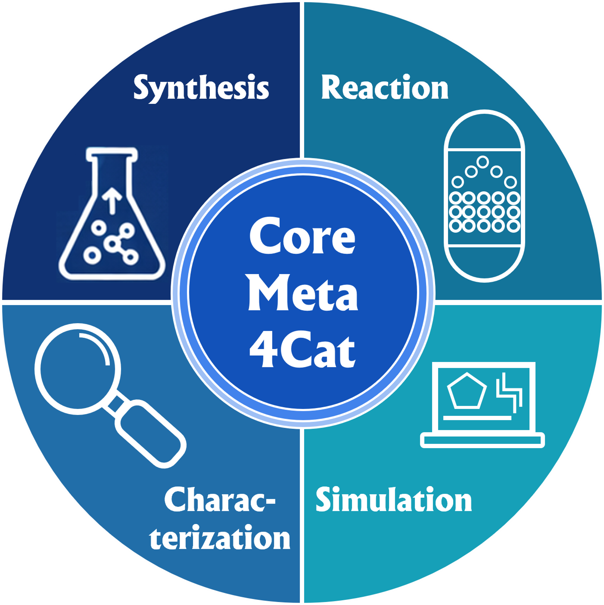

# Getting Started with CoreMeta4Cat

Adopting a new metadata standard does not have to mean changing how you work overnight. CoreMeta4Cat is designed to be useful at every stage of the journey — including if you stay with spreadsheets permanently. This page explains a pragmatic, low-barrier path towards semantically richer catalysis data, regardless of whether you use an Electronic Lab Notebook, a data management platform, or simply Excel.

> **Want to check your dataset right away?** Download the [CoreMeta4Cat metadata list](https://nfdi4cat.github.io/CoreMeta4Cat/latest/assets/coremeta4cat_vocabulary.xlsx) to see which fields apply to your data class. A user-friendly **Metadata Checker** tool that does this automatically is coming soon — no schema knowledge required.

<div style="text-align: center;">
    <a>
    
    </a>
</div>

---

## Why a gradual adoption path?

Catalysis research is diverse. Some groups run highly standardised high-throughput experiments that map naturally onto structured data formats. Others carry out unique, exploratory investigations where no two experiments follow quite the same procedure — and where investing in dedicated data management infrastructure may not be feasible.

CoreMeta4Cat does not require you to change your data collection workflows. What it offers instead is a **shared vocabulary**: a set of agreed-upon terms and field names that can be applied to your existing data, wherever it lives, at whatever level of detail works for your group.

The path below goes from the simplest possible adoption — using the vocabulary reference to understand which terms exist — all the way to fully machine-readable, schema-validated records. You can stop at any point and already have something more interoperable than before.

```
Level 1 ──► Understand the vocabulary hierarchy
               ↓
Level 2 ──► Annotate your own spreadsheets with CoreMeta4Cat terms
               ↓
Level 3 ──► Write a lightweight JSON converter for your sheet structure
               ↓
Level 4 ──► Validate records against the full CoreMeta4Cat schema
```

---

## Level 1 — The vocabulary reference workbook

To help you understand which terms exist and how they relate to each other, CoreMeta4Cat provides a reference Excel workbook. This workbook is **not a data entry form to fill in** — it is a structured overview of the CoreMeta4Cat vocabulary hierarchy, organised by data class, that you can use as a lookup reference when designing or annotating your own data sheets.

<div style="text-align: center; margin: 1.5em 0;">
  <a href="https://nfdi4cat.github.io/CoreMeta4Cat/dev/assets/coremeta4cat_vocabulary.xlsx"
     style="display: inline-block; padding: 0.7em 1.6em; background: #1976d2; color: white;
            border-radius: 4px; text-decoration: none; font-weight: bold;">
    ⬇ Download the CoreMeta4Cat vocabulary reference workbook (dev)
  </a>
  <p style="margin: 10px 0 0; font-size: 0.85em; opacity: 0.7;">
    Always up to date with the latest schema.
  </p>
  <p style="margin: 14px 0 0; font-size: 0.85em;">
    <a href="../assets/coremeta4cat_vocabulary.xlsx">Looking for the workbook matching this version of the docs instead?</a>
  </p>
</div>

The workbook has five sheets:

| Sheet | What it shows |
|---|---|
| **CoreMeta4Cat** | The minimal global field set — catalyst type, support, metal, metal loading, additive, reaction type — with the CURIE for each |
| **Synthesis** | The full hierarchy of synthesis fields, organised by synthesis step (solvation, mixing, milling, pH adjustment, filtration, crystallisation, washing, dilution, impregnation, drying, calcination, sieving, pelleting), with the corresponding CURIE shown in each column header |
| **Characterization** | Method parameter fields and result fields for the characterisation techniques currently in CoreMeta4Cat, showing which ontology terms apply to which measurement parameters and result types |
| **Reaction** | The full hierarchy of reaction / catalytic test fields — reactor type, operation mode, reactants, solvent, products, analysis — with CURIEs |
| **Simulation** | Fields for computational simulations — simulation method (DFT, molecular dynamics, microkinetics, Monte Carlo) and the calculated properties they produce — with CURIEs |

Use this workbook to find the right term for a concept you want to annotate, and to understand how fields nest within each other (e.g. which parameters belong under a calcination step versus a drying step).

### How the workbook is organised

Every data sheet (`CoreMeta4Cat`, `Synthesis`, `Characterization`, `Reaction`, `Simulation`) uses the same ten columns — `label`, `type`, `domain`, `M / R / O`, `range`, `multivalued`, `inlined as list`, `unit`, `uri`, `description` — and the same colour coding. Both are explained on the workbook's own **Legend** sheet, reproduced here:

<div style="text-align: center; margin: 1.5em 0;">
  
</div>

In short:

- **Red rows (M)** — Mandatory. A record is not schema-valid without these fields.
- **Blue rows (R)** — Recommended. Strongly encouraged; omitting them reduces how findable and reusable your data is.
- **Green rows (O)** — Optional. Useful additional context, not required.
- **Grey italic rows** — Inherited from chemdcat-ap, the underlying chemistry data model CoreMeta4Cat is built on. Shown for reference only — they can't be added, changed, or removed through the inbox workflow described below. Open a GitHub issue instead if one of these needs correcting.

A `class`-type row (also shown in grey, but bold rather than plain italic) means the field above it doesn't take a plain value — it expands into its own structured sub-record. Here is a real excerpt from the **Synthesis** sheet, showing Mandatory, Recommended, Optional, and Inherited rows together, and how the `solvent` field expands into the inherited `ChemicalEntity` class and its own sub-fields (`inchi`, `inchikey`, `smiles`, …):

<div style="text-align: center; margin: 1.5em 0;">
  
</div>

### Proposing a change: the inbox workflow in detail

The workbook is also the mechanism for proposing changes to the vocabulary — no coding required. This section goes into more detail than the [Contributing guide](contributing.md); read that page for the short version.

1. **Download** the workbook using the button above. Don't create a new workbook from scratch — always start from the current generated file, since the automated check compares your edits against the live schema.
2. **Edit the `Synthesis`, `Characterization`, `Reaction`, or `Simulation` sheet directly.**
      - To correct an existing field: change its `M / R / O`, `range`, `unit`, `uri`, or `description` cell.
      - To add a new field: add a new row with a `label`, set `type` to `slot`, and set `domain` to the class it belongs to (leave `domain` empty for a top-level field).
      - To add a new field that needs a brand-new class (e.g. a field whose `range` doesn't exist yet): add both the new `slot` row and the new `class` row in the same submission — they're validated together.
      - Don't touch the grey inherited rows, don't rename sheets, and don't rename or remove column headers — the automated check matches on exact names.
3. **Place the edited file** at `inbox/coremeta4cat_vocabulary.xlsx` in a new branch and **open a pull request**.
4. **Wait for the automated check.** A GitHub Action reads your edited workbook, diffs it against the schema, and posts the results as a comment directly on your PR — usually within a couple of minutes.
5. **Address anything it flags**, then push again (the check re-runs automatically on every push). Once it passes cleanly, a maintainer reviews and merges — the schema, generated docs, and this workbook all update automatically.

#### Typical messages from the automated check

The check reports three kinds of things: ✅ changes it applied, ⚠️ warnings worth reviewing, and ❌ errors that block the merge. Here are the messages you're most likely to see, in the check's own wording:

| Message | What it means | How to fix it |
|---|---|---|
| ❌ *Required sheet **Synthesis** is missing.* | A sheet was renamed, reordered, or deleted. | Re-download the template rather than reusing a modified copy; don't rename sheets. |
| ❌ *Missing required column(s): label, M / R / O.* | A column header in row 1 was edited, reordered, or deleted. | Re-download the template; leave the header row untouched. |
| ❌ *Invalid M/R/O value `'Mandatory'`. Only **M** (Mandatory), **R** (Recommended), or **O** (Optional) are accepted.* | The `M / R / O` cell contains something other than the single letter. | Use exactly `M`, `R`, or `O`. |
| ❌ *Unknown range `Concentraton`. This type is not a recognized primitive or schema class.* | The `range` cell references a type that doesn't exist (often a typo, or a new class you forgot to add as its own row). | Use an existing primitive (`string`, `float`, `integer`, `boolean`) or class name, or add the new class as its own row in the same submission. |
| ⚠️ *Range changed: `string` → `Mass`. This structural change may invalidate existing data files.* | You changed what type of value a field expects. | Often intentional and fine — the test suite checks it automatically, and a maintainer reviews the impact before merging. |
| ⚠️ *This edit changes `has_atmosphere`'s single, global definition — it is not scoped to `Synthesis` alone. It will also change `has_atmosphere` for: `CatalyticReaction`.* | The field you edited is reused by more than one class (shown in the `domain` column of the *other* sheets too), so your edit affects all of them, not just the one you meant to change. | If that's what you intended, no action needed. If you only meant to change it for one class, say so in the PR description — a maintainer can add a class-specific override instead of changing the shared definition. |
| ⚠️ *Present in the schema but **missing** from your workbook (expected label: *drying device*). It will be removed from `Impregnation`.* | A row that exists in the current schema isn't in your uploaded sheet — usually because a row was accidentally deleted or filtered out before saving. | If accidental, re-download the template and redo your edits without deleting rows. If you genuinely meant to remove the field, no action needed — a maintainer reviews deletions before merging. |

!!! info "Nothing changed?"
    If your edits don't actually differ from the current schema, the check simply reports *"✅ The workbook is fully aligned with the schema — no changes were needed."* and closes with nothing to merge.

---

## Level 2 — Annotating your own spreadsheets

The most lightweight form of CoreMeta4Cat adoption is to take your **existing experimental spreadsheets** — the ones you already use to record synthesis batches, characterisation measurements, or reaction results — and annotate their column headers with the corresponding CoreMeta4Cat terms.

### How the annotation works

Each column header in your sheet gets a CURIE added alongside it, whether in a second header row, as a cell comment, or simply appended to the header text. There is no prescribed format — what matters is that the machine-readable term is present and unambiguous.

The vocabulary reference workbook uses a two-line pattern in each column header as a model:

```
Human-readable label
voc4cat:XXXXXXX
```

Here are some representative examples drawn from the reference workbook:

**Synthesis fields:**

| Label in reference workbook | CURIE | Meaning |
|---|---|---|
| `institution` | `voc4cat:0007842` | Institution where the catalyst was prepared |
| `catalyst` | `voc4cat:0007014` | Catalyst type |
| `Preparation method` | `voc4cat:0007016` | Synthesis method |
| `Support` | `voc4cat:0007825` | Support material |
| `Precursor 1` | `voc4cat:0007794` | First precursor compound |
| `Precursor 1 amount` | `voc4cat:0007038` | Mass of precursor used |
| `Metal loading, nominal (wt%)` | `voc4cat:0007815` | Nominal metal loading |
| `calcination final temperature` | `voc4cat:0000058` | Final calcination temperature |
| `calcination heating rate` | `voc4cat:0000059` | Heating rate during calcination |
| `calcination dwelling time` | `voc4cat:0000060` | Hold time at calcination temperature |

**Reaction / catalytic test fields:**

| Label in reference workbook | CURIE | Meaning |
|---|---|---|
| `Reaction type` | `voc4cat:0007010` | Type of catalytic reaction |
| `Catalyst mass [g]` | `voc4cat:0007792` | Mass of catalyst loaded |
| `Reactor` | `voc4cat:0007017` | Reactor type |
| `operation mode` | `voc4cat:0000108` | Batch or flow operation |
| `Reactor temperature` | `voc4cat:0007032` | Reactor temperature range |
| `Solvent` | `voc4cat:0007246` | Reaction solvent |

**Characterisation result fields:**

| Technique | Key result fields and terms |
|---|---|
| BET analysis (`AFP:0003761`) | Specific surface area (`voc4cat`), pore volume, average pore diameter |
| Powder XRD (`CHMO:0000158`) | Phase identification, crystallite size (Scherrer), phase quantification |
| XPS (`CHMO:0000404`) | Assigned species, binding energy, oxidation state, elemental concentration |
| ICP-OES | Chemical element (`SIO`), concentration (`afo`) |
| GC / GC-MS (`CHMO:0000497`) | Retention time (`voc4cat`), peak area |
| TEM (`CHMO:0000080`) | Average particle size (`voc4cat`), particle shape |
| UV-Vis (`CHMO:0000292`) | Wavelength (`voc4cat`), absorbance, attenuation coefficient |
| NMR (liquid) | Chemical shift (`NMRCV`), signal intensity, multiplet feature |

You do not need to annotate every column at once. Starting with the most essential fields — **catalyst type, support, metal loading, and reaction type** — already makes your spreadsheet far more comparable against data from other groups, because you are now using the same vocabulary terms.

!!! info "What are CURIEs?"
    A CURIE (Compact URI) like `voc4cat:0007014` is shorthand for a full web address: `https://w3id.org/nfdi4cat/voc4cat_0007014`. Every CoreMeta4Cat term — whether it comes from Voc4Cat or another controlled vocabulary such as CHMO or QUDT — resolves to a human-readable definition at its CURIE's address. This means a computer — or another researcher — can unambiguously identify what each field means, regardless of what language your column header is written in. That is the foundation of interoperability.

### The CoreMeta4Cat minimal field set

The **CoreMeta4Cat** sheet in the reference workbook shows the smallest useful annotation set — fields that apply to every catalysis dataset regardless of data class. If you annotate nothing else, annotating these fields is already a meaningful step:

| Field | CURIE | Notes |
|---|---|---|
| Catalyst type | `voc4cat:0007014` | Choose from: heterogeneous (`voc4cat:0007003`), homogeneous (`voc4cat:0007804`), hybrid (`voc4cat:0007805`), biocatalyst |
| Support | `voc4cat:0007825` | e.g. Al₂O₃, SiO₂, TiO₂, carbon |
| Metal | — | e.g. Ni, Pd, Pt, Cu |
| Metal loading (wt%) | `voc4cat:0007815` | Nominal loading |
| Additive | `voc4cat:0007793` | Dopant (`voc4cat:0007847`), molecular modifier, or ligand (`voc4cat:0007809`) |
| Molar ratio metal : additive | — | e.g. 1:0.1 |
| Reaction type | `voc4cat:0007010` | Use RXNO terms where available |

---

## Level 3 — Writing a JSON converter for your sheet

If you want your spreadsheet data to be fully machine-readable — for repository deposit, automated validation, or integration with other tools — the next step is to write a **converter** that reads your sheet and outputs a JSON record conforming to the CoreMeta4Cat schema.

### One converter per sheet structure

Every research group's spreadsheets are different. Column order, naming conventions, the number of precursor columns, how reactions and syntheses are organised — these vary between groups, and often between projects within a group. Rather than attempting to handle this diversity with a single general-purpose tool, CoreMeta4Cat takes a different approach: **each group writes a small, transparent converter script tailored to their own sheet layout.**

This may sound like more work, but in practice a converter for a synthesis sheet is typically 30–80 lines of Python. It is a one-time investment per sheet structure, and it produces a permanent, auditable record of exactly how your data maps onto the CoreMeta4Cat schema. If your sheet layout changes, you update the converter accordingly.

The CURIE annotations you added in Level 2 do most of the work: they are the mapping key that tells the converter which column corresponds to which CoreMeta4Cat field.

### What a minimal converter looks like

```python
import openpyxl, json

wb = openpyxl.load_workbook("my_synthesis_data.xlsx")
ws = wb["Synthesis"]

# Read column headers — these carry the CURIE annotations
# so you know exactly which column maps to which CoreMeta4Cat field
headers = [cell.value for cell in ws[1]]

records = []
for row in ws.iter_rows(min_row=2, values_only=True):
    data = dict(zip(headers, row))
    if not any(data.values()):
        continue  # skip empty rows

    record = {
        "type": "CatalysisDataset",
        "was_generated_by": [{
            "type": "Synthesis",
            "nominal_composition": data.get("Name"),           # dct:title
            "realized_plan": {
                "type": "Impregnation",
                # voc4cat:0000058 — calcination final temperature
                "calcination_final_temperature":
                    data.get("calcination final temperature"),
                # voc4cat:0000060 — calcination dwelling time
                "calcination_dwelling_time":
                    data.get("calcination dwelling time"),
            },
            "had_input_entity": [{
                "type": "Precursor",
                "name": data.get("Precursor 1"),               # voc4cat:0007794
                "precursor_quantity": data.get("Precursor 1 amount")  # voc4cat:0007038
            }]
        }],
        "is_about_entity": [{
            "type": "CatalystSample",
            "support": data.get("Support"),                    # voc4cat:0007825
            "metal_loading_nominal":
                data.get("Metal loading, nominal (wt%)")       # voc4cat:0007815
        }]
    }
    records.append(record)

with open("synthesis_records.json", "w") as f:
    json.dump(records, f, indent=2, ensure_ascii=False)
```

The column names passed to `data.get(...)` are the same human-readable labels you already have in your sheet header. The CURIEs in the comments document the semantic meaning of each mapping for anyone reading the script later.

### The resulting JSON record

Running this converter produces a record like the following, which is a valid CoreMeta4Cat JSON instance:

```json
{
  "type": "CatalysisDataset",
  "rdf_type": { "id": "voc4cat:0007001", "title": "heterogeneous catalysis" },
  "was_generated_by": [
    {
      "type": "Synthesis",
      "nominal_composition": "5wt% Ni/Al2O3",
      "realized_plan": {
        "type": "Impregnation",
        "calcination_final_temperature": 500.0,
        "calcination_dwelling_time": 4.0
      },
      "had_input_entity": [
        {
          "type": "Precursor",
          "name": "Ni(NO3)2·6H2O",
          "precursor_quantity": 1.24
        }
      ]
    }
  ],
  "is_about_entity": [
    {
      "type": "CatalystSample",
      "support": "Al2O3",
      "metal_loading_nominal": 5.0
    }
  ]
}
```

---

## Level 4 — Validating against the full schema

Once you have JSON records, you can validate them against the CoreMeta4Cat schema using standard [LinkML tooling](https://linkml.io/linkml/):

```bash
pip install linkml

linkml-validate \
  --schema coremeta4cat.yaml \
  --target-class CatalysisDataset \
  synthesis_records.json
```

Validation reports which mandatory fields are missing, which values fall outside the expected type or controlled vocabulary, and which cross-record links are incomplete. You do not need to reach full validation compliance in one step — treat it as a diagnostic tool that tells you where the gaps are and helps you prioritise what to add next.

---

## What each level gives you

| Level | What you need to do | What you gain |
|---|---|---|
| **1 — Vocabulary reference** | Browse the reference workbook | Understanding of the field hierarchy and available CoreMeta4Cat terms |
| **2 — Annotate your sheets** | Add CURIEs to column headers in your existing sheets | Vocabulary-consistent, comparable data — no programming required |
| **3 — Write a converter** | One small Python script per sheet structure | Fully machine-readable JSON records, ready for repository deposit |
| **4 — Validate** | Run `linkml-validate` | Schema compliance, SHACL shapes, RDF export, semantic querying |

Levels 1 and 2 require no programming knowledge and no changes to your existing data collection workflows. They represent a genuine step towards FAIR catalysis data on their own terms.

---

## Next steps

- **Browse the full field reference** for each pillar → [Schema Reference](elements/overview.md)
- **Understand the design** behind CoreMeta4Cat → [Design Patterns](design-patterns.md)
- **Add a field not yet in the schema** → [How to Extend](how-to-extend.md)
- **Schema source and issue tracker** → [CoreMeta4Cat on GitHub](https://github.com/HendrikBorgelt/CoreMeta4Cat)
