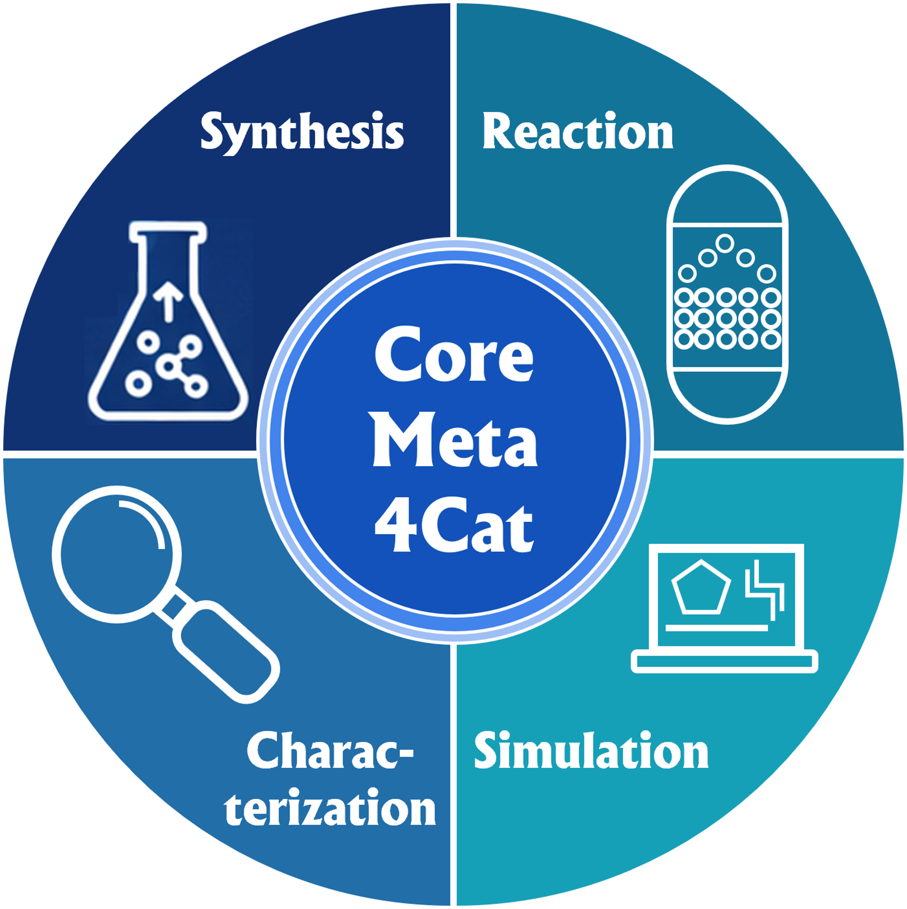

# Getting Started with CoreMeta4Cat

Adopting a new metadata standard does not have to mean changing how you work overnight. CoreMeta4Cat is designed to be useful at every stage of the journey — including if you stay with spreadsheets permanently. This page explains a pragmatic, low-barrier path towards semantically richer catalysis data, regardless of whether you use an Electronic Lab Notebook, a data management platform, or simply Excel.

> **Want to check your dataset right away?** Download the [CoreMeta4Cat metadata list](https://nfdi4cat.github.io/CoreMeta4Cat/latest/assets/coremeta4cat_vocabulary.xlsx) to see which fields apply to your data class. A user-friendly **Metadata Checker** tool that does this automatically is coming soon — no schema knowledge required.

<div style="text-align: center;">
    <a>
    
    </a>
</div>

---

## Why a gradual adoption path?

Catalysis research is diverse. Some groups run highly standardised high-throughput experiments that map naturally onto structured data formats. Others carry out unique, exploratory investigations where no two experiments follow quite the same procedure — and where investing in dedicated data management infrastructure may not be feasible.

CoreMeta4Cat does not require you to change your data collection workflows. What it offers instead is a **shared vocabulary**: a set of agreed-upon terms and field names that can be applied to your existing data, wherever it lives, at whatever level of detail works for your group.

The path below goes from the simplest possible adoption — using the vocabulary reference to understand which terms exist — all the way to fully machine-readable, schema-validated records. You can stop at any point and already have something more interoperable than before.

```
Level 1 ──► Understand the vocabulary hierarchy
               ↓
Level 2 ──► Annotate your own spreadsheets with CoreMeta4Cat terms
               ↓
Level 3 ──► Write a lightweight JSON converter for your sheet structure
               ↓
Level 4 ──► Validate records against the full CoreMeta4Cat schema
```

---

## Level 1 — The vocabulary reference workbook

To help you understand which terms exist and how they relate to each other, CoreMeta4Cat provides a reference Excel workbook. This workbook is **not a data entry form to fill in** — it is a structured overview of the CoreMeta4Cat vocabulary hierarchy, organised by data class, that you can use as a lookup reference when designing or annotating your own data sheets.

<div style="text-align: center; margin: 1.5em 0;">
  <a href="https://nfdi4cat.github.io/CoreMeta4Cat/dev/assets/coremeta4cat_vocabulary.xlsx"
     style="display: inline-block; padding: 0.7em 1.6em; background: #1976d2; color: white;
            border-radius: 4px; text-decoration: none; font-weight: bold;">
    ⬇ Download the CoreMeta4Cat vocabulary reference workbook (dev)
  </a>
  <p style="margin: 10px 0 0; font-size: 0.85em; opacity: 0.7;">
    Always up to date with the latest schema.
  </p>
  <p style="margin: 14px 0 0; font-size: 0.85em;">
    <a href="../assets/coremeta4cat_vocabulary.xlsx">Looking for the workbook matching this version of the docs instead?</a>
  </p>
</div>

The workbook has five sheets:

| Sheet | What it shows |
|---|---|
| **CoreMeta4Cat** | The Layer 1 fields every catalysis dataset carries — the research field (`rdf type`), the activity that generated the data, and the reaction and catalyst the dataset is about — with the CURIE for each |
| **Synthesis** | The synthesis fields, organised by preparation method (impregnation, co-precipitation, sol-gel, solvothermal, …), including the step parameters each method shares, such as drying and calcination, with the CURIE for each field |
| **Characterization** | The method parameter fields of the characterisation techniques currently in CoreMeta4Cat, with the ontology term for each technique and parameter |
| **Reaction** | The reaction / catalytic test fields — reactor type, reaction conditions, reactants, solvent, products, product analysis — with CURIEs |
| **Simulation** | Fields for computational simulations — simulation method (DFT, molecular dynamics, microkinetics, Monte Carlo) and the calculated properties they produce — with CURIEs |

Use this workbook to find the right term for a concept you want to annotate, and to understand how fields nest within each other (e.g. which parameters belong under a calcination step versus a drying step).

### How the workbook is organised

Every data sheet (`CoreMeta4Cat`, `Synthesis`, `Characterization`, `Reaction`, `Simulation`) uses the same ten columns — `label`, `type`, `domain`, `M / R / O`, `range`, `multivalued`, `inlined as list`, `unit`, `uri`, `description` — and the same colour coding. Both are explained on the workbook's own **Legend** sheet, reproduced here:

<div style="text-align: center; margin: 1.5em 0;">
  
</div>

In short:

- **Red rows (M)** — Mandatory. A record is not schema-valid without these fields.
- **Blue rows (R)** — Recommended. Strongly encouraged; omitting them reduces how findable and reusable your data is.
- **Green rows (O)** — Optional. Useful additional context, not required.
- **Grey italic rows** — Inherited from chemdcat-ap, the underlying chemistry data model CoreMeta4Cat is built on. Shown for reference only — they can't be added, changed, or removed through the inbox workflow described below. Open a GitHub issue instead if one of these needs correcting.

A `class`-type row (also shown in grey, but bold rather than plain italic) means the field above it doesn't take a plain value — it expands into its own structured sub-record. Here is a real excerpt from the **Synthesis** sheet, showing Mandatory, Recommended, Optional, and Inherited rows together, and how the `solvent` field expands into the inherited `ChemicalEntity` class and its own sub-fields (`inchi`, `inchikey`, `smiles`, …):

<div style="text-align: center; margin: 1.5em 0;">
  
</div>

!!! info "Why labels look like `SolGel` or `impregnation_temperature`"
    Labels are the schema's machine-readable names, which cannot contain spaces or hyphens. Classes (structured records such as a preparation method) are written in PascalCase, e.g. `SolGel` for the sol-gel method, and fields in snake_case, e.g. `impregnation_temperature`. The `description` column gives the plain-language meaning. See [How to Extend: Rule 7](how-to-extend.md#general-rules) for the full conventions.

### Proposing a change: the inbox workflow in detail

The workbook is also the mechanism for proposing changes to the vocabulary — no coding required. This section goes into more detail than the [Contributing guide](contributing.md); read that page for the short version.

1. **Download** the workbook using the button above. Don't create a new workbook from scratch — always start from a generated file: it keeps a hidden copy of how it looked when it was generated, so the automated check can tell exactly which rows you changed and applies only those.
2. **Edit the `Synthesis`, `Characterization`, `Reaction`, or `Simulation` sheet directly.**
      - To correct an existing field: change its `M / R / O`, `range`, `multivalued`, `unit`, `uri`, or `description` cell. An `M / R / O` change applies to that row's class only.
      - To remove a field from a class: delete its row.
      - To add a new field: add a new row with a `label`, set `type` to `slot`, and set `domain` to the class it belongs to (leave `domain` empty for a top-level field).
      - To add a new field that needs a brand-new class (e.g. a field whose `range` doesn't exist yet): add both the new `slot` row and the new `class` row in the same submission — they're validated together.
      - Don't touch the grey inherited rows, don't rename sheets, and don't rename or remove column headers — the automated check matches on exact names.
3. **Place the edited file** at `inbox/coremeta4cat_vocabulary.xlsx` in a new branch and **open a pull request**.
4. **Wait for the automated check.** A GitHub Action reads your edited workbook, diffs it against the schema, and posts the results as a comment directly on your PR — usually within a couple of minutes.
5. **Address anything it flags**, then push again (the check re-runs automatically on every push). Once it passes cleanly, a maintainer reviews and merges — the schema, generated docs, and this workbook all update automatically.

#### Typical messages from the automated check

The check reports three kinds of things: ✅ changes it applied, ⚠️ warnings worth reviewing, and ❌ errors that block the merge. Here are the messages you're most likely to see, in the check's own wording:

| Message | What it means | How to fix it |
|---|---|---|
| ❌ *Required sheet **Synthesis** is missing.* | A sheet was renamed, reordered, or deleted. | Re-download the template rather than reusing a modified copy; don't rename sheets. |
| ❌ *Missing required column(s): label, M / R / O.* | A column header in row 1 was edited, reordered, or deleted. | Re-download the template; leave the header row untouched. |
| ❌ *Invalid M/R/O value `'Mandatory'`. Only **M** (Mandatory), **R** (Recommended), or **O** (Optional) are accepted.* | The `M / R / O` cell contains something other than the single letter. | Use exactly `M`, `R`, or `O`. |
| ❌ *Unknown range `Concentraton`. This type is not a recognized primitive or schema class.* | The `range` cell references a type that doesn't exist (often a typo, or a new class you forgot to add as its own row). | Use an existing primitive (`string`, `float`, `integer`, `boolean`) or class name, or add the new class as its own row in the same submission. |
| ❌ *This workbook was made from an older template: it has no hidden `_baseline` sheet …* | The file was downloaded before the check started recording what you changed, or the hidden sheet was removed. | Download the current workbook and copy your edits into it. |
| ❌ *The URI `VOC4CAT:0005056` uses the prefix `VOC4CAT:`, which the schema does not declare. Did you mean `voc4cat:`?* | The `uri` cell uses a prefix the schema doesn't know (prefixes are case-sensitive). | Use one of the schema's prefixes, or a full `https://` IRI. |
| ❌ *The unit `2026-01-02 00:00:00` looks like a date …* | Excel converted what you typed in the `unit` cell (e.g. `1/2`). | Format the cell as Text and enter the UCUM code again (e.g. `Cel`, `mol/L`). |
| ⚠️ *Not applied: `has_temperature` is inherited from a chemdcat-ap base class and is read-only here …* | You edited a grey, read-only row. | Open an issue, or ask a maintainer to change it in the schema directly. |
| ⚠️ *Conflict: the description of … was also changed in the schema after you downloaded the workbook …* | Someone changed the same cell on `main` after your download; your value was applied. | Check that your value is still what you want. |
| ⚠️ *Range changed: `string` → `Mass`. This structural change may invalidate existing data files.* | You changed what type of value a field expects. | Often intentional and fine — the test suite checks it automatically, and a maintainer reviews the impact before merging. |
| ⚠️ *This edit changes `has_atmosphere`'s single, global definition — it is not scoped to `Synthesis` alone. It will also change `has_atmosphere` for: `CatalyticReaction`.* | The field you edited is reused by more than one class (shown in the `domain` column of the *other* sheets too), so your edit affects all of them, not just the one you meant to change. | If that's what you intended, no action needed. If you only meant to change it for one class, say so in the PR description — a maintainer can add a class-specific override instead of changing the shared definition. |
| ⚠️ *Present in the schema but **missing** from your workbook (expected label: *drying device*). It will be removed from `Impregnation`.* | A row that exists in the current schema isn't in your uploaded sheet — usually because a row was accidentally deleted or filtered out before saving. | If accidental, re-download the template and redo your edits without deleting rows. If you genuinely meant to remove the field, no action needed — a maintainer reviews deletions before merging. |

!!! info "Nothing changed?"
    If your edits don't actually differ from the current schema, the check simply reports *"✅ The workbook is fully aligned with the schema — no changes were needed."* and closes with nothing to merge.

---

## Level 2 — Annotating your own spreadsheets

The most lightweight form of CoreMeta4Cat adoption is to take your **existing experimental spreadsheets** — the ones you already use to record synthesis batches, characterisation measurements, or reaction results — and annotate their column headers with the corresponding CoreMeta4Cat terms.

### How the annotation works

Each column header in your sheet gets a CURIE added alongside it, whether in a second header row, as a cell comment, or simply appended to the header text. There is no prescribed format — what matters is that the machine-readable term is present and unambiguous.

A simple pattern is a two-line header: your own label, then the CURIE from the `uri` column of the reference workbook:

```
Human-readable label
voc4cat:XXXXXXX
```

Here are some typical column headers, with the CURIE and the field they correspond to in the reference workbook:

**Synthesis fields:**

| Column in your sheet (example) | CURIE | Field in the reference workbook |
|---|---|---|
| `Preparation method` | `voc4cat:0007016` | `PreparationMethod`; each method has its own class, e.g. `Impregnation` (`voc4cat:0007028`) |
| `Support` | `voc4cat:0008104` | `catalyst support` |
| `Metal loading, nominal (wt%)` | `coremeta4cat:nominal_composition` | `nominal composition`, e.g. 5 wt% Ni on Al₂O₃ |
| `Precursor 1` | `voc4cat:0007794` | `Precursor` |
| `Precursor 1 amount` | `voc4cat:0008118` | `precursor quantity` |
| `calcination final temperature` | `coremeta4cat:hasCalcinationTemperatureRange` | `has calcination temperature range` |
| `calcination heating rate` | `voc4cat:0008116` | `has calcination heating rate` |
| `calcination dwelling time` | `voc4cat:0000060` | `has calcination dwelling time` |

**Reaction / catalytic test fields:**

| Column in your sheet (example) | CURIE | Field in the reference workbook |
|---|---|---|
| `Reaction type` | `voc4cat:0007010` | the reaction's `rdf type` (Layer 1), e.g. hydrogenation (`voc4cat:0000260`) |
| `Catalyst mass [g]` | `voc4cat:0008141` | `catalyst mass` |
| `Catalyst form` | `voc4cat:0000016` | `catalyst form` |
| `Reactor` | `voc4cat:0007018` | `ChemicalReactor`; each reactor type has its own class, e.g. `FixedBedReactor` |
| `Reactor temperature` | `voc4cat:0007032` | `reactor temperature range` |
| `Pressure` | `voc4cat:0000118` | `experiment pressure` |
| `Solvent` | `SIO:010417` | `used solvent` (`DissolvingSubstance`) |

**Characterisation techniques:**

| Technique (class in the workbook) | CURIE | Key method parameter fields |
|---|---|---|
| BET analysis (`BET`) | `enm:0000064` | adsorbate gas, degassing temperature, measurement temperature |
| Powder XRD (`PowderXRD`) | `CHMO:0000158` | 2θ range, step size, X-ray source, monochromator |
| XPS (`XPS`) | `CHMO:0000404` | X-ray source, pass energy, spot size, energy range |
| ICP-OES / ICP-AES (`ICPAES`) | `CHMO:0000267` | element analysed, calibration method, detection limit |
| GC-MS (`GCMS`) | `CHMO:0000497` | carrier gas, column type, oven temperature range, split ratio |
| TEM (`TransmissionElectronMicroscopy`) | `voc4cat:0000078` | gun type, acceleration voltage, magnification setting |
| UV-Vis (`UVVisSpectroscopy`) | `voc4cat:0000079` | wavelength range, path length, solvent |
| NMR (`NMRSpectroscopy`) | `voc4cat:0000073` | acquisition nucleus, solvent, irradiation frequency, pulse sequence |

The characterisation fields describe how a measurement was made, not its results. Result columns can be annotated with Voc4Cat terms where they exist, for example specific surface area (`voc4cat:0000013`), retention time (`voc4cat:0007260`) or particle size (`voc4cat:0008212`).

You do not need to annotate every column at once. Starting with the most essential fields — **catalyst type, catalyst composition and support, and reaction type** — already makes your spreadsheet far more comparable against data from other groups, because you are now using the same vocabulary terms.

!!! info "What are CURIEs?"
    A CURIE (Compact URI) like `voc4cat:0007014` is shorthand for a full web address: `https://w3id.org/nfdi4cat/voc4cat_0007014`. Every CoreMeta4Cat term — whether it comes from Voc4Cat or another controlled vocabulary such as CHMO or QUDT — resolves to a human-readable definition at its CURIE's address. This means a computer — or another researcher — can unambiguously identify what each field means, regardless of what language your column header is written in. That is the foundation of interoperability.

### The CoreMeta4Cat minimal field set

The **CoreMeta4Cat** sheet in the reference workbook lists the Layer 1 fields that apply to every catalysis dataset, regardless of data class: the research field (`rdf type`), the activity that generated the data (`was generated by`), and, recommended, the reaction and the catalyst the dataset is about (`is about activity`, `is about entity`). In a spreadsheet, the columns that feed these fields are the ones to annotate first. If you annotate nothing else, annotating these is already a meaningful step:

| Column | CURIE | Notes |
|---|---|---|
| Catalyst type | `voc4cat:0007014` | Becomes the research field. One or more of: heterogeneous (`voc4cat:0007001`), homogeneous (`voc4cat:0000294`), bio- (`voc4cat:0000204`), electro- (`voc4cat:0000216`) or photocatalysis (`voc4cat:0000001`) |
| Reaction type | `voc4cat:0007010` | A Voc4Cat reaction term, e.g. hydrogenation (`voc4cat:0000260`) or CO₂ hydrogenation (`voc4cat:0000259`) |
| Catalyst composition | `coremeta4cat:nominal_composition` | e.g. 5 wt% Ni on Al₂O₃; metal, loading and support can also be separate columns |
| Support | `voc4cat:0008104` | e.g. Al₂O₃, SiO₂, TiO₂, carbon |

---

## Level 3 — Writing a JSON converter for your sheet

If you want your spreadsheet data to be fully machine-readable — for repository deposit, automated validation, or integration with other tools — the next step is to write a **converter** that reads your sheet and outputs a JSON record conforming to the CoreMeta4Cat schema.

### One converter per sheet structure

Every research group's spreadsheets are different. Column order, naming conventions, the number of precursor columns, how reactions and syntheses are organised — these vary between groups, and often between projects within a group. Rather than attempting to handle this diversity with a single general-purpose tool, CoreMeta4Cat takes a different approach: **each group writes a small, transparent converter script tailored to their own sheet layout.**

This may sound like more work, but in practice a converter for a synthesis sheet is typically 30–80 lines of Python. It is a one-time investment per sheet structure, and it produces a permanent, auditable record of exactly how your data maps onto the CoreMeta4Cat schema. If your sheet layout changes, you update the converter accordingly.

The CURIE annotations you added in Level 2 do most of the work: they are the mapping key that tells the converter which column corresponds to which CoreMeta4Cat field.

### What a minimal converter looks like

The example sheet has one row per synthesis, with the column labels from Level 2 plus one measured
property (here the BET surface area), because every synthesis record needs at least one.

```python
import json
import openpyxl

BASE = "https://example.org/my-group/"  # your own namespace for identifiers

# Sheet values mapped to vocabulary terms
RESEARCH_FIELD = {
    "heterogeneous": {"id": "voc4cat:0007001", "title": "heterogeneous catalysis"},
    "homogeneous": {"id": "voc4cat:0000294", "title": "homogeneous catalysis"},
}
METHOD = {  # preparation method -> class_uri of the CoreMeta4Cat method class
    "impregnation": "voc4cat:0007028",
    "co-precipitation": "voc4cat:0007795",
}


def quantity(value, kind, unit):
    """A value with its QUDT quantity kind and unit."""
    return {"value": value,
            "has_quantity_type": f"http://qudt.org/vocab/quantitykind/{kind}",
            "unit": f"https://qudt.org/vocab/unit/{unit}"}


wb = openpyxl.load_workbook("my_synthesis_data.xlsx")
ws = wb["Synthesis"]
headers = [cell.value for cell in ws[1]]

records = []
for n, row in enumerate(ws.iter_rows(min_row=2, values_only=True), start=1):
    data = dict(zip(headers, row))
    if not any(data.values()):
        continue  # skip empty rows
    name = data["Name"]
    method = data["Preparation method"]                     # voc4cat:0007016
    temperature = data["calcination final temperature"]     # in deg C
    catalyst = {"id": f"{BASE}catalyst-{n}", "title": name}

    records.append({
        "id": f"{BASE}dataset-{n}",
        "title": [f"Synthesis of {name}"],
        "description": [f"Converted from my_synthesis_data.xlsx, row {n + 1}."],
        "rdf_type": [RESEARCH_FIELD[data["Catalyst type"]]],  # voc4cat:0007014
        "was_generated_by": [{
            "id": f"{BASE}synthesis-{n}",
            "activity_designator": "Synthesis",
            "title": [f"{method} of {name}"],
            "nominal_composition": [
                f"{data['Metal loading, nominal (wt%)']} wt% {data['Metal']} on {data['Support']}"],
            "catalyst_measured_properties": [
                f"BET surface area: {data['BET surface area (m2/g)']} m2/g"],
            "catalyst_support": [data["Support"]],             # voc4cat:0008104
            "had_input_entity": [{
                "id": f"{BASE}precursor-{n}-1",
                "title": data["Precursor 1"],                   # voc4cat:0007794
                "precursor_quantity": [                         # voc4cat:0008118
                    quantity(data["Precursor 1 amount"], "Mass", "GM")],
            }],
            "had_output_entity": [catalyst],
            "realized_plan": {
                "id": f"{BASE}method-{n}",
                "plan_designator": METHOD[method],              # which method class this is
                "title": method,
                "has_calcination_temperature_range": [{
                    "min_value": temperature, "max_value": temperature,
                    "has_quantity_type": "http://qudt.org/vocab/quantitykind/Temperature",
                    "unit": "https://qudt.org/vocab/unit/DEG_C"}],
                "has_calcination_dwelling_time":                # voc4cat:0000060
                    quantity(data["calcination dwelling time"], "Time", "HR"),
            },
        }],
        "is_about_entity": [catalyst],
    })

with open("synthesis_records.json", "w", encoding="utf-8") as f:
    json.dump(records, f, indent=2, ensure_ascii=False)
```

The column names used in `data[...]` are the same human-readable labels you already have in your sheet
header, and the CURIEs in the comments document the meaning of each mapping. Three things turn the sheet
into a valid record: every dataset, activity, method and entity gets an identifier in your own namespace
(`BASE`); sheet values such as the catalyst type and the preparation method are mapped to vocabulary terms
(`RESEARCH_FIELD`, `METHOD`); and numbers are written with their quantity kind and unit (`quantity()`).
`plan_designator` tells software which method class the plan belongs to (here `Impregnation`), which makes
the calcination fields of that class available.

### The resulting JSON record

Running this converter on a row for a 5 wt% Ni/Al₂O₃ catalyst produces the following record, which passes
the validation shown in Level 4:

```json
{
  "id": "https://example.org/my-group/dataset-1",
  "title": [
    "Synthesis of 5Ni/Al2O3"
  ],
  "description": [
    "Converted from my_synthesis_data.xlsx, row 2."
  ],
  "rdf_type": [
    {
      "id": "voc4cat:0007001",
      "title": "heterogeneous catalysis"
    }
  ],
  "was_generated_by": [
    {
      "id": "https://example.org/my-group/synthesis-1",
      "activity_designator": "Synthesis",
      "title": [
        "impregnation of 5Ni/Al2O3"
      ],
      "nominal_composition": [
        "5 wt% Ni on Al2O3"
      ],
      "catalyst_measured_properties": [
        "BET surface area: 182 m2/g"
      ],
      "catalyst_support": [
        "Al2O3"
      ],
      "had_input_entity": [
        {
          "id": "https://example.org/my-group/precursor-1-1",
          "title": "Ni(NO3)2·6H2O",
          "precursor_quantity": [
            {
              "value": 1.24,
              "has_quantity_type": "http://qudt.org/vocab/quantitykind/Mass",
              "unit": "https://qudt.org/vocab/unit/GM"
            }
          ]
        }
      ],
      "had_output_entity": [
        {
          "id": "https://example.org/my-group/catalyst-1",
          "title": "5Ni/Al2O3"
        }
      ],
      "realized_plan": {
        "id": "https://example.org/my-group/method-1",
        "plan_designator": "voc4cat:0007028",
        "title": "impregnation",
        "has_calcination_temperature_range": [
          {
            "min_value": 500,
            "max_value": 500,
            "has_quantity_type": "http://qudt.org/vocab/quantitykind/Temperature",
            "unit": "https://qudt.org/vocab/unit/DEG_C"
          }
        ],
        "has_calcination_dwelling_time": {
          "value": 4,
          "has_quantity_type": "http://qudt.org/vocab/quantitykind/Time",
          "unit": "https://qudt.org/vocab/unit/HR"
        }
      }
    }
  ],
  "is_about_entity": [
    {
      "id": "https://example.org/my-group/catalyst-1",
      "title": "5Ni/Al2O3"
    }
  ]
}
```

---

## Level 4 — Validating against the full schema

Once you have JSON records, you can validate them against the CoreMeta4Cat schema using standard [LinkML tooling](https://linkml.io/linkml/):

```bash
pip install linkml

linkml-validate \
  --schema coremeta4cat.yaml \
  --target-class CatalysisDataset \
  synthesis_records.json
```

Validation reports which mandatory fields are missing, which values fall outside the expected type or controlled vocabulary, and which cross-record links are incomplete. You do not need to reach full validation compliance in one step — treat it as a diagnostic tool that tells you where the gaps are and helps you prioritise what to add next.

### Checking recommended fields

By default, `linkml-validate` only enforces mandatory fields. LinkML can also list the recommended fields a record leaves empty. Save this configuration as `recommended.yaml`:

```yaml
plugins:
  JsonschemaValidationPlugin:
    closed: true
  RecommendedSlotsPlugin: {}
```

and pass it to the same command:

```bash
linkml-validate \
  --schema coremeta4cat.yaml \
  --target-class CatalysisDataset \
  --config recommended.yaml \
  synthesis_records.json > report.txt
```

Every missing recommended field appears as a `[WARN]` line in `report.txt`; mandatory fields still appear as `[ERROR]`. This includes the recommended fields that CoreMeta4Cat inherits from DCAT-AP+ and ChemDCAT-AP. To see only those of the CoreMeta4Cat data classes:

```bash
grep -E "on class '(CatalysisDataset|Synthesis|Characterization|CatalyticReaction|Simulation)'" report.txt
```

If your repository or project requires recommended fields, let the check fail when any are missing:

```bash
! grep -q '^\[WARN\]' report.txt
```

The check looks at each field's class as declared in the schema. The parameters of a specific method or technique (for example `PowderXRD` or `TPR`) are checked when that record is validated on its own, with its class as `--target-class`.

---

## What each level gives you

| Level | What you need to do | What you gain |
|---|---|---|
| **1 — Vocabulary reference** | Browse the reference workbook | Understanding of the field hierarchy and available CoreMeta4Cat terms |
| **2 — Annotate your sheets** | Add CURIEs to column headers in your existing sheets | Vocabulary-consistent, comparable data — no programming required |
| **3 — Write a converter** | One small Python script per sheet structure | Fully machine-readable JSON records, ready for repository deposit |
| **4 — Validate** | Run `linkml-validate` | Schema compliance, SHACL shapes, RDF export, semantic querying |

Levels 1 and 2 require no programming knowledge and no changes to your existing data collection workflows. They represent a genuine step towards FAIR catalysis data on their own terms.

---

## Next steps

- **Understand the design** behind CoreMeta4Cat → [Design Patterns](design-patterns.md)
- **Browse the full field reference** for each pillar → [Schema Reference](elements/overview.md)
- **See real records and reusable examples** → [Working with Data](working-with-data/index.md)
- **Add a field not yet in the schema** → [How to Extend](how-to-extend.md)
- **Schema source and issue tracker** → [CoreMeta4Cat on GitHub](https://github.com/nfdi4cat/CoreMeta4Cat)
